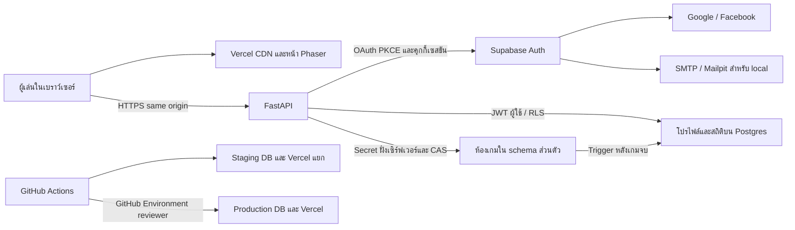

# สถาปัตยกรรม ChessX

## ระบบเดิมและระบบเป้าหมาย

เว็บ ChessMess ที่เผยแพร่อยู่ใช้ Vite/Phaser บน Vercel กับ FastAPI ห้องออนไลน์เก็บสถานะใน schema ส่วนตัวของ Supabase ผู้เล่นแขกใช้โทเค็นที่นั่งและดึงสถานะผ่าน HTTP พร้อม ETag สาขานี้เพิ่ม Auth, โปรไฟล์, สถิติ และกระบวนการ release

## Login และ session

1. หน้าเกมส่ง POST provider ที่เปิดใช้ไปยัง FastAPI โดยใช้ origin เดียวกัน
2. FastAPI เก็บ PKCE verifier ในคุกกี้ `HttpOnly` อายุสั้น และส่งลิงก์ Supabase ที่ผูกกับ S256 challenge และ callback ของ environment
3. Supabase จัดการ state กับ provider และส่ง authorization code กลับที่ `/api/account/oauth/callback`
4. FastAPI แลก code กับ verifier ตรวจข้อมูลบัญชี แล้วตั้งคุกกี้ access/refresh แยก path เบราว์เซอร์ได้รับข้อมูล UI ที่เลือกส่งเท่านั้น callback กลับมายัง path ภายในที่กำหนดไว้
5. การแก้บัญชีตรวจ user กับ Supabase ฝั่งเซิร์ฟเวอร์ หากมี TOTP ที่ยืนยันแล้ว ใช้ AAL2 กับการเปลี่ยนสำคัญ พร้อมตรวจเวลายืนยันล่าสุดในบางรายการ
6. Recovery ใช้ OTP กับคุกกี้สำหรับกู้รหัสผ่านโดยเฉพาะ เมื่อมี MFA ให้ยืนยัน TOTP ก่อนตั้งรหัสใหม่

Supabase รับผิดชอบบัญชีและการเชื่อม identity อัตโนมัติ แอปไม่ผูกบัญชีตามอีเมลจาก request หรือ metadata การผูกด้วยปุ่มตั้งค่าบัญชียืนยันเจ้าของเดิมซ้ำ และตรวจว่า callback กลับมาที่ user เดิม การ login ต้องได้รับอีเมลยืนยันจาก Supabase สำหรับการเปรียบเทียบอีเมลของ Google/Facebook ใช้ผลของ Supabase Auth และทดสอบ provider จริงบน staging ก่อนเปิดใช้ [PKCE](https://supabase.com/docs/guides/auth/sessions/pkce-flow) · [Identity linking](https://supabase.com/docs/guides/auth/auth-identity-linking) · [TOTP](https://supabase.com/docs/guides/auth/auth-mfa/totp)

## ข้อมูลและ RLS

| ตาราง | ข้อมูล | สิทธิ์ |
|---|---|---|
| `auth.users` | อีเมล, provider identities, password hash และตัวระบุ Supabase | Supabase Auth จัดการ |
| `public.profiles` | user ID, username, display name, avatar URL, timestamp | authenticated อ่านของตนเอง แก้เฉพาะสามคอลัมน์โปรไฟล์ |
| `public.player_stats` | จำนวนเกม ชนะ แพ้ เสมอ และ timestamp | เจ้าของอ่านได้ การบันทึกมาจาก SQL ฝั่งเซิร์ฟเวอร์ |
| `public.match_history` | เกมของเจ้าของ, โหมด, ฝั่ง, ผล, เวลาจบ | เจ้าของอ่านได้ |
| `chessmess_private.*` | ห้อง, โควตา, binding ที่นั่ง, audit | RPC และ DB role ที่กำหนด อ่าน/เขียนโดยเซิร์ฟเวอร์ |

ทุกตาราง `public` ที่เพิ่มเปิด RLS และใช้ `(select auth.uid())` กับเจ้าของ โปรไฟล์ใหม่สร้างจาก trigger บน `auth.users` ที่กำหนด schema และ search path ให้ชัดเจน รายการเกมและสถิติใช้ FK และ unique `match_id, player_id` หลีกเลี่ยงการนับซ้ำ แถวที่อ้างบัญชีลบตามการลบบัญชี [Supabase RLS](https://supabase.com/docs/guides/database/postgres/row-level-security)

เกมใช้ผลที่ FastAPI คำนวณจากตาเดินและฝ่ายที่มีสิทธิ์ การ commit ตรวจ revision กับ room identity หลังเกมจบ trigger บันทึกผลให้ทั้งสองบัญชีเมื่อเป็นบัญชีที่ตรวจแล้วและแตกต่างกัน เกมแขกเล่นได้ตามเดิม แท็บที่ session บัญชีหมดอายุระหว่างแข่งยังใช้งานด้วยสิทธิ์ที่นั่งเดิมได้

## อายุข้อมูลและขอบเขต

อีเมลและโปรไฟล์ใช้กับการจัดการบัญชี เก็บระหว่างใช้งานและลบเมื่อผู้ใช้ลบบัญชีตามขั้นตอน รายการห้องหมดอายุจาก API ที่ 15 นาทีระหว่างรอ และ 6 ชั่วโมงหลังเริ่ม ชื่อเล่นเป็นข้อมูลที่แสดงให้คู่เล่น สถิติรวมอยู่กับบัญชี ส่วนประวัติใช้เป้าหมาย 365 วัน และ audit 90 วัน ผู้ดูแลต้องตั้งงานตามรอบเพื่อบังคับใช้อายุข้อมูลดังกล่าว ไฟล์ backup ที่เข้ารหัสมีรอบเก็บแยก กำหนดผู้ติดต่อและ privacy notice ตามการใช้งานจริงก่อนเปิด Auth [ตัวอย่าง Privacy Notice ของสำนักงาน PDPC](https://gppc.pdpc.or.th/wp-content/uploads/GPPC-PDPC_Register_Privacy-Notice-%E0%B8%89%E0%B8%9A%E0%B8%B1%E0%B8%9A%E0%B8%A2%E0%B9%88%E0%B8%AD_05062024.pdf)

## Load และการขยาย

Static assets ใช้ CDN ห้องใช้ polling ตาม revision ซึ่งลด payload ด้วย 304 เบื้องต้นมีเพดานห้อง 256 และโควตาต่อแหล่งที่มา เหมาะกับการเปิดตัวแบบกลุ่มเล็ก วัด p95 ของ room poll/commit, 429, CAS conflict, DB CPU/I/O และ bandwidth ก่อนขยาย ข้อมูลเกมหลักเขียนผ่าน PostgREST RPC จึงไม่เปิด connection ตรงจากทุก invocation คำสั่ง migration ใช้ connection สำหรับงาน admin ตาม [คู่มือการเชื่อม Postgres](https://supabase.com/docs/guides/database/connecting-to-postgres)

ถ้าปริมาณ poll เป็นคอขวด ค่อยเพิ่ม Realtime แบบ private channel ส่งเฉพาะเลข revision ต่อห้อง แล้วให้ API ส่ง snapshot ตามสิทธิ์ ส่วน leaderboard/index เพิ่มเมื่อมีระบบอันดับที่กำหนดไว้ ยังไม่มีงานที่ต้องใช้ read replica หรือ Edge Functions ในสาขานี้
